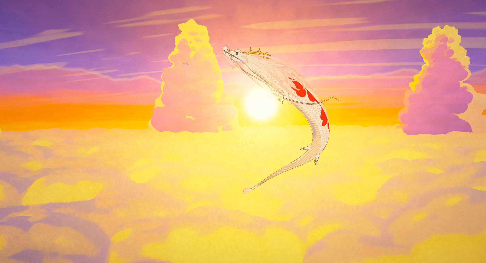
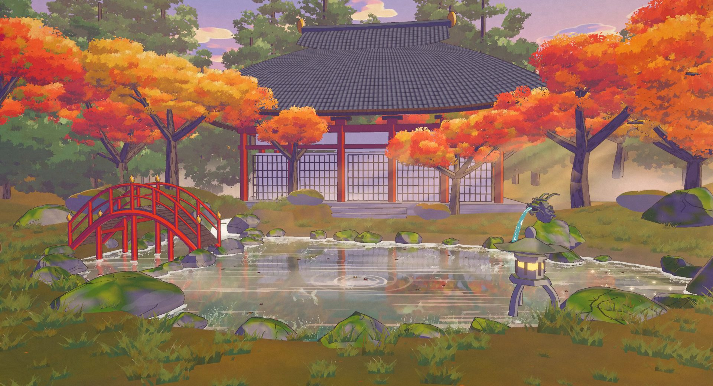
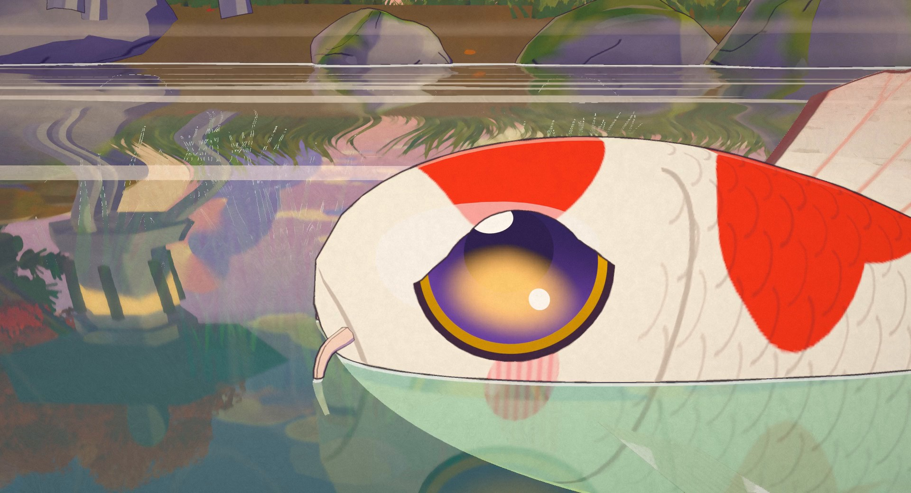
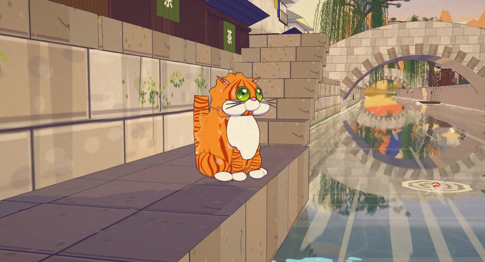
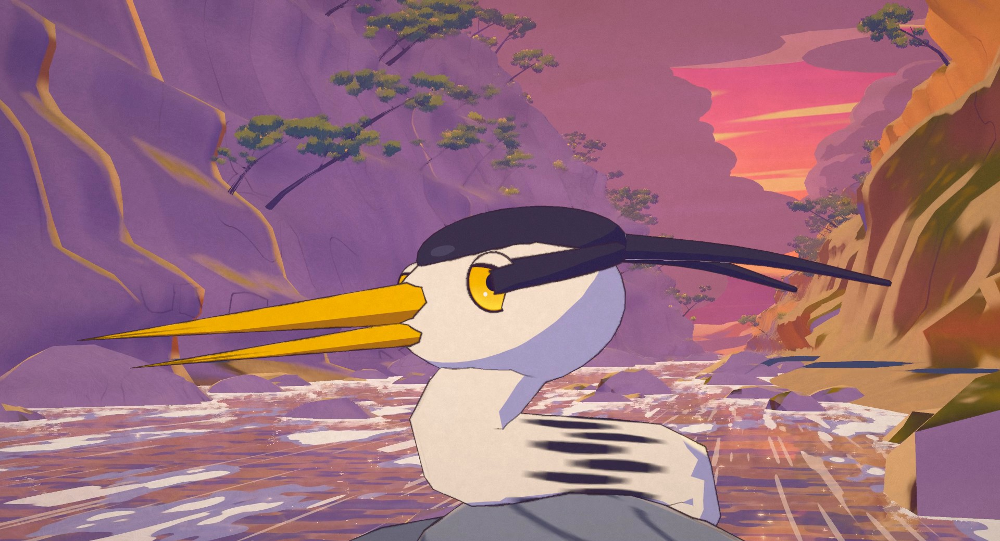
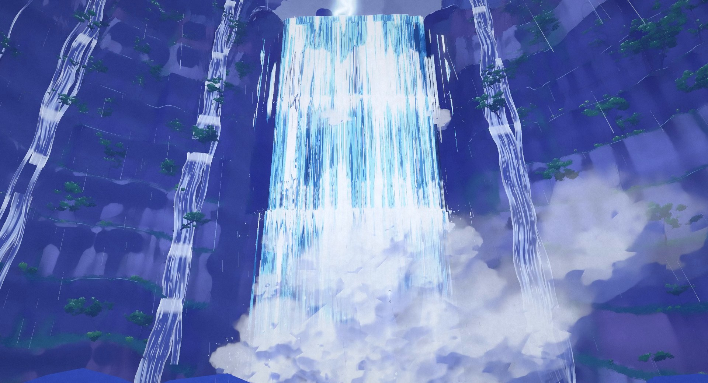
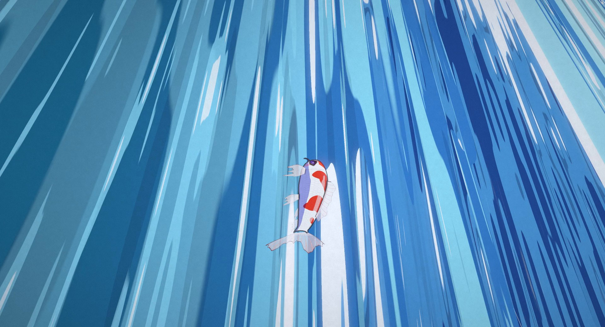
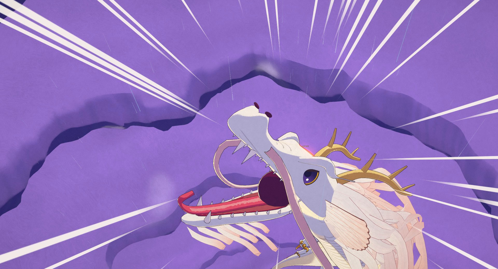

# RYŪMON · 竜門

An 88-second anime short where every frame is rendered by code: no video model, no image model, no hand-drawn frames,
no external assets. Hi, the smallest koi in a temple pond, sees an old stone dragon at dawn and swims upstream through
a bamboo forest, a canal town and a sunset gorge to a colossal waterfall in a night storm. It fails, sinks, remembers,
and climbs the falling water, until a lightning bolt at the top turns it into a white dragon wearing its own red
markings, which flies up into the dawn and all the way home.



| | |
|---|---|
|  |  |
|  |  |
|  |  |

**Watch:** download `dist/ryumon.html` and open it in any browser. It is one self-contained file (28 MB, a lighter
encode of the film with its soundtrack) and works offline.

---

## How it looks like anime

The film is a three.js (r160, WebGL2) scene drawn through a custom multi-pass pipeline (`src/anime/post.js`) that
imitates a cel + painted-background production:

| Pass | What it does |
|---|---|
| refraction + mirror | water sets first render what lies under the surface (koi, pebbles, weed) into a pre-pass, so the ponds, streams and the plunge pool show depth-banded water, caustics and contact foam; a camera mirrored about the water plane renders the reflection at half resolution, sampled in screen space with ripple rings, rain wobble and strokes. Objects on layer 2 exist only in the reflection (the dragon gliding across the pond in the last shot) |
| main (MRT) | colour + emissive, and a data buffer (view normal, depth, material id) |
| Kuwahara paint | depth-aware 8-sector anisotropic Kuwahara "brush" on painted pixels only (skies, clouds, cliffs, maples, bamboo canopy) → gouache look; a gentler radius on water so reflections keep their shapes |
| ink | hand-inked lines on cel pixels only: id / depth / normal edges, pressure noise, line boil on twos |
| atmosphere | depth haze, painted glows (sun, lightning, the crown spot), light shafts; underwater grade with a bright surface seen from below, soft caustic lines and god rays |
| FX overlay | impact frames (inverted ink frame, white flash), drawn speed lines, lightning flash, warm memory vignette; the drawn FX geometry (rain, falling water sheets, spray, bubbles, splash crowns, bolts, sparkles) are unlit cel FX ids that skip the ink |
| bloom | glow from emissive pixels only (eyes, sun, bolts, the scarlet crown) |
| grade + grain | exposure, saturation, contrast, lift/gain, vignette, paper texture and film grain, fades |

* **Everything is 3D under the drawing.** Hi and the pond koi are procedural skinned bodies on a 14-bone spine with
  a travelling swim wave, translucent fins with drawn rays and anime eyes with moods; the dragon is a 300 m skinned
  tube along a spline with a sculpted head, hinged jaw, antlers, a flowing mane and Hi's own patch pattern, and
  `grow(k)` morphs the koi into it. The heron, the cat and the stone dragon spout are built the same way. The 300 m
  waterfall is four layered sheets simulated column by column from the cliff's lip and ledges.
* **Characters are on twos, FX on threes**, like film anime: poses change 12 times a second, rain, water sheets and
  sparkles 8 times a second, cameras move on ones.
* **Every frame is a pure function of time.** Frames render in any order; the few effects that remember earlier
  frames (ripples, sparkles) are replayed without drawing before a chunk starts, so the render is chunked and
  resumable and every chunk matches a single in-order render of the whole film.
* **The sound is fully synthesized** in Python with numpy: koto, music box, shakuhachi-like flute, strings, brass,
  choir, taiko, temple bell, birdsong, bamboo knocks, stream, rain, thunder, the falls' roar, a heron's call, a cat's
  "mrrp", heartbeat and the dragon's roar, no samples. One 4-note koi motif grows into the dragon's theme. Named hits
  are placed from the picture's event list so each one peaks one frame after its event; the hook ends in a hard cut to
  digital silence and the last push before the top drops 14 dB to a near silence.
* **No image or video models, no downloaded art, no external assets.** Every texture (maple and bamboo leaves, willow
  strands, rock strata, the noren with 湯 茶 酒 宿 lettered in the system's own fonts, cloud brushwork, scales) is
  painted by code into canvases at load time.



## How it was made

One director session and parallel department agents, all working from a shared production bible
([CONTRACT.md](CONTRACT.md)): story, designs, sets, the 39-shot table, story cues, the department API and file
ownership. The director built the scaffold (engine, boot, shot table, colour script, render tools) and then the
departments ran at the same time, each owning its own files and checking its own work with rendered stills:

* **Vale**: the temple pond at dawn (maples, temple hall, red bridge, stone lantern, inlet cascade, the spout rock),
  the bamboo stream and the canal town with its bridges, willows and houses, plus their painted skies.
* **Heights**: the sunset gorge with its rapids and the heron's rock, the colossal waterfall cliff in the storm, and
  the sky set (the storm chimney and the dawn sea of clouds).
* **Creatures**: Hi, the pond koi, the heron, the cat, the stone dragon spout and the dragon, with their poses, eyes
  and the koi-to-dragon morph.
* **Water**: every water surface from above and below, the waterfall curtain, mist and spray, rain, lightning bolts,
  splashes, bubbles, sparkles, the transformation effect, and the underwater and caustics passes in the engine.
* **Direction** (two departments, act one and act two): cameras, colour script per shot and choreography.
* **Sound**: the score and effects, built from the same shot table and event list as the picture.

Departments talked through requests in a shared status log, never by editing each other's files. After two rounds of
department work, one round of review stills and one round of fixes, the film was rendered once, start to finish; the
last shot was later rebuilt and only its chunk re-rendered.

**Numbers**

| | |
|---|---|
| length | 88 s, 2112 frames at 24 fps, 39 shots, 6 sets (pond, bamboo, town, gorge, falls, sky), 4 characters (Hi, heron, cat, dragon) + 8 pond koi |
| frame | 1920×1040, rendered at scale 2 (3840×2080 internally, downsampled in the page), one sample per frame |
| speed | about 510 ms per final frame including GPU readback, on one mid-range desktop GPU (20 to 600 ms depending on the shot) |
| render | 18 chunks of up to 120 frames, about 22 minutes for the whole film, plus about 3 minutes of encoding |
| sound | 48 kHz 24-bit stereo, -14 LUFS, true peak under -2 dBTP, 27 synced hits, about 100 s to synthesize |
| code | about 11,400 lines of JavaScript for the film, 1,800 lines of Python for the tools and the score |

## Run it

Requirements: Python 3.11+, `pip install -r requirements.txt`, `playwright install chromium`, and `ffmpeg` on `PATH`
(or set `FFMPEG=/path/to/ffmpeg`). The shell scripts need bash (on Windows, Git Bash works).

Scrub the film live (any static server works; this one sends the right MIME types and no caching):

```bash
python tools/serve.py 8760
# open http://127.0.0.1:8760/index.html        (?s=2 for the final render scale, ?f=1032 to start on a frame)
```

Free camera test view: `index.html?test=1&set=FALLS&cam=0,20,120&at=0,120,0&fov=40&t=43`.

Render stills for review (server running; `s:` shot, `t:` seconds, `f:` frame, `q:` a test view):

```bash
python tools/snap.py --port 8760 --scale 2 --out out/snap s:s19 t:76.4 f:1759 "q:test=1&set=FALLS&cam=0,20,120&at=0,120,0&fov=40&t=43=name:mytest"
```

Full build: picture (resumable lossless chunks), soundtrack, final MP4, single-file player:

```bash
bash tools/chunks.sh 2 8760          # -> out/chunks/c_NNNN.mkv (starts the server if needed)
python tools/sound/build.py          # -> out/audio/mix.wav, checks loudness, silences and hit sync
bash tools/finalize.sh               # -> out/ryumon.mp4 (H.264 CRF 16 + AAC 192k)
python tools/player.py               # -> dist/ryumon.html (2-pass H.264 lite encode, embedded, < 30 MB)
```

## Layout

```
index.html              workbench: scrub, play, shot timeline; ?headless=1 capture mode, ?s=2 render scale
CONTRACT.md             the production bible every department worked from
src/main.js             boot: renderer, AnimePost, scene, camera, sets, departments, window.FILM
src/shots.js            the 39 shots, story CUES, evalFrame(frame) -> state
src/look.js             colour script presets per set
src/anime/post.js       the anime pipeline: materials (cel, painted, mirror, cards, sky) and the post passes
src/vale*.js            the pond, the bamboo stream, the canal town
src/heights*.js         the gorge, the waterfall, the sky
src/creatures.js, creatures/   Hi, the pond koi, the heron, the cat, the dragon, the stone spout
src/water*.js, fx*.js   water surfaces, the falls curtain, rain, bolts, splashes, sparkles (API in src/water/README.md)
src/direction/          act1.js (s01-s19) and act2.js (s20-s39): cameras, looks, choreography
tools/                  serve, snap (stills), render + chunks + finalize (film), player (dist), sheet
tools/sound/            the synthesized soundtrack: dsp, instruments, voices, score, master, check, events.json
vendor/                 three.module.js (r160)
dist/ryumon.html        the offline player
docs/                   stills from the film
```

Code is MIT licensed (see [LICENSE](LICENSE)). The pass chain, the Kuwahara paint and the ink ideas were adapted from
"sunshower" (MIT); its licence line is kept in `src/anime/post.js`.

Made with Fable 5.5.
